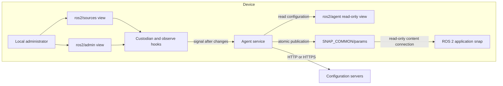

# ROS 2 confdb agent

This proof of concept provides a reusable `ros2-confdb-agent` snap. It reads an
ordered list of ROS 2 parameter-file URLs from **confdb**, downloads each
source to a separate file without modifying its content, and shares the files
read-only with application snaps through the content interface. The application
continues to pass a file to ROS 2 with `--params-file`.

## Architecture



The signed schema is named `ros2` and is owned by the developer account. Its
three views map to the same storage:

| View | Purpose | Access |
| --- | --- | --- |
| `sources` | Ordered source list | Read/write |
| `admin` | Download policy and credentials | Read/write |
| `agent` | Combined configuration for the service | Read-only |

The snap has a separate custodian plug for **each** view. Snapd selects the
custodian of the view being accessed, not just a custodian of overlapping
storage. Source and admin change hooks validate proposed data and invalidate
in-flight refreshes before commit. An observe hook signals the service after a
change; it does not wait for downloads or a confdb read.

## Local installation and setup

These commands are for a **later test device**; they have not been run as part
of this implementation. Enabling experimental confdb is system-wide.

```sh
sudo snap set system experimental.confdb=true
sudo snap ack <confdb-schema>
sudo snap install --dangerous ./ros2-confdb-agent_0.1.0_amd64.snap

sudo snap connect ros2-confdb-agent:ros2-agent
sudo snap connect ros2-confdb-agent:ros2-sources
sudo snap connect ros2-confdb-agent:ros2-admin
snap connections ros2-confdb-agent
```

All three confdb plugs must be connected: the service reads through `agent`,
and `sources` and `admin` each need their own connected custodian for writes.
Store-published snaps whose publisher owns the schema may be auto-connected;
do not assume that for a locally installed, unasserted snap.

Set a source list. `version` is an integer revision marker: increment it to
trigger a refresh when remote content changes without a URL change.

```sh
sudo snap set -t "$ACCOUNT_ID/ros2/sources" \
  'sources=[{"source":"https://config.example.com/common.yaml","output":"common.yaml","version":1},{"source":"https://config.example.com/robot-42.yaml","output":"teleop.yaml","version":1}]'

sudo snap get -d "$ACCOUNT_ID/ros2/sources"
sudo snap logs -f ros2-confdb-agent.daemon
```

Each source must have a unique `output` filename. A change hook rejects
duplicate outputs before committing the confdb change. Configurations left
with duplicate outputs by an older version must be updated to use distinct
names; until then the agent refuses to download or remove files.

Setting `sources=[]` removes all previously managed output files. The agent
does not delete unrelated files in its output directory and refuses to
overwrite an existing file it has not recorded as managed.

## Download policy and credentials

The `admin` view holds `policy` and `credentials`. Missing policy fields use
these defaults:

| Field | Default | Meaning |
| --- | --- | --- |
| `allow-http` | `true` | Permit HTTP URLs. |
| `allow-https` | `true` | Permit HTTPS URLs. |
| `allowlist-enabled` | `false` | Restrict hosts only when enabled. |
| `allowed-hosts` | `[]` | Exact hosts or `*.example.com` patterns, without ports. |
| `timeout-seconds` | `60` | Deadline per source download, including redirects and body. |
| `max-source-mib` | `10` | Maximum decoded bytes per source. |
| `max-redirects` | `5` | Maximum redirects per source; `0` disables redirects. |

For example:

```sh
sudo snap set -t "$ACCOUNT_ID/ros2/admin" \
  'policy={"allow-http":false,"allow-https":true,"allowlist-enabled":true,"allowed-hosts":["config.example.com","*.robots.example.com"],"timeout-seconds":60,"max-source-mib":10,"max-redirects":5}'
```

`*.robots.example.com` matches subdomains at any depth but not the apex
`robots.example.com`. Allowed hosts may use any port. Hostnames are normalized
for matching. Policy is checked for the initial URL and every redirect.
Reducing permissions is allowed even if existing sources become blocked: the
service is signalled to cancel in-flight work, and subsequent refreshes refuse
blocked fetches, log failures, and retain the last published output. Requests
already sent cannot be recalled. A changed source list must satisfy the
proposed policy before it is committed.

Credentials are a list keyed by normalized origin: scheme, hostname, and
effective port. There can be only one credential per origin. URL userinfo is
not allowed.

```json
[
  {
    "origin": "https://config.example.com",
    "method": "basic",
    "username": "robot",
    "secret": "EXAMPLE_ONLY"
  },
  {
    "origin": "https://tokens.example.com",
    "method": "bearer",
    "secret": "EXAMPLE_ONLY"
  },
  {
    "origin": "http://keys.example.com:8080",
    "method": "api-key",
    "header": "X-API-Key",
    "secret": "EXAMPLE_ONLY"
  }
]
```

Set the complete list with `snap set -t "$ACCOUNT_ID/ros2/admin"
'credentials=[...]'`. Do not put real secrets literally in shell history.
Command-line arguments can also be visible to other privileged processes.
Authenticated HTTP is permitted when HTTP is enabled, but credentials and
content then travel without TLS. On redirects, the previous authentication
headers are removed; only credentials explicitly configured for the new
origin are applied.

The schema marks the entire credentials list as `secret`, which filters it
from non-admin confdb reads on snapd 2.76 and later. This is **access
filtering, not encryption at rest**. Local administrators and the root-running
agent can read it. Source URLs are not secret fields; do not put credentials in
URLs or assume query strings are hidden by confdb. Agent errors avoid logging
URLs, queries, and configured secrets. Published parameter files have mode
`0644`, may contain sensitive application values, and should not be treated as
confidential merely because the content connection is read-only.

## Connect a consumer snap

For a complete buildable ROS 2 Humble/core22 consumer based on
`canonical/snap_configuration`, see the
[teleop example](examples/ros2-teleop/README.md). It includes a sample file and
instructions for serving it, configuring the agent, and observing changes.

Other consumer snaps need a matching content plug, for example:

```yaml
plugs:
  ros2-params:
    interface: content
    content: ros2-confdb-params
    target: $SNAP_DATA/ros2-params
    default-provider: ros2-confdb-agent:ros-params

apps:
  application:
    # Keep the application's existing command and other plugs.
    plugs: [ros2-params]
```

Connect it if it is not automatically connected:

```sh
sudo snap connect <consumer-snap>:ros2-params ros2-confdb-agent:ros-params
```

The launcher can then pass
`$SNAP_DATA/ros2-params/teleop.yaml` to `--params-file`. Replacing the file
does not automatically update an already-running ROS node; the consumer must
restart or implement its own reload behavior.

## Refresh and publication behavior

- The service refreshes at startup, on relevant confdb changes, and when
  explicitly requested with `sudo snap run ros2-confdb-agent.refresh`. The
  command requests an asynchronous refresh; inspect
  `snap logs ros2-confdb-agent.daemon` for the result. There is no periodic
  polling after retries are exhausted.
- Each source is downloaded to its own unique `output`. Downloaded content is
  written byte-for-byte after HTTP decoding; the agent does not parse, validate,
  or merge the files. ROS and the consumer remain responsible for validating
  their contents.
- Each output is published separately using a staged file and atomic rename.
  A failed download or size check leaves that output's last good file in place;
  publication errors are logged. Other outputs can still succeed. Explicitly
  removed managed outputs are deleted. Generation checks prevent a stale
  refresh from publishing or recreating an output after a committed
  configuration change.
- A failed output or cleanup is attempted once and retried three times, with
  waits of 5, 10, and 20 seconds between retry rounds. Processing other outputs
  can add to those waits. A new change or manual request starts a new refresh.
- HTTP gzip responses are size-limited after decompression. Unsupported
  content encodings are rejected. Only HTTP status 200 is accepted. The
  configured per-source limit applies, with an additional 64 MiB ceiling per
  output even if an administrator raises `max-source-mib`.

## Development

```sh
go test ./... -race
go vet ./...
```

The earlier application-managed polling approach is described in
[Configure a snap: pull a configuration from a server](https://canonical-robotics.readthedocs-hosted.com/en/latest/how-to-guides/packaging/config-a-snap-pull-from-a-server/).
Remote delegation and fleet management can be explored after the local POC and
real consumer integration have been validated.
