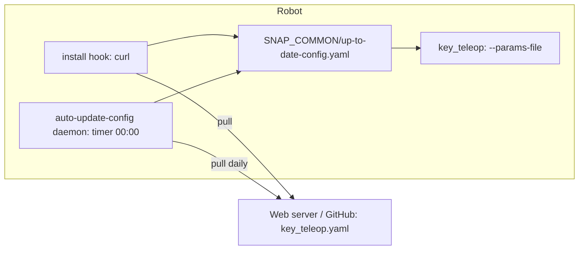
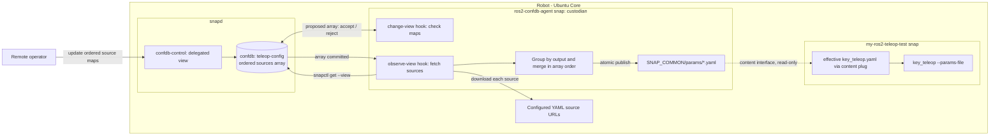
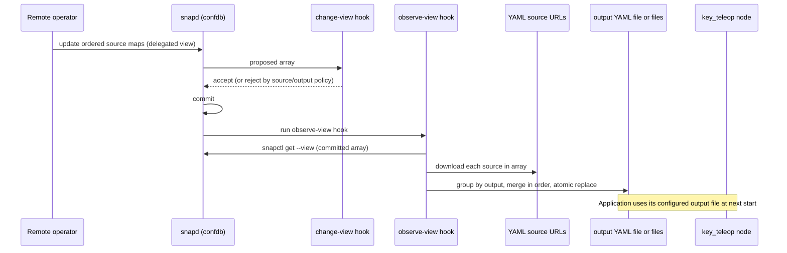

# Remote ROS 2 snap configuration with confdb

## Summary

The Robotics team's current approach, [Configure a snap: pull a configuration from a server](https://canonical-robotics.readthedocs-hosted.com/en/latest/how-to-guides/packaging/config-a-snap-pull-from-a-server/), downloads a ROS 2 parameters YAML file from a web server. The download runs in an `install` hook and then once a day from a timer daemon. This POC replaces application-managed polling with **remote confdb**. Confdb stores an ordered list of YAML sources and output filenames. The `ros2-confdb-agent` sidecar snap downloads the files, merges sources that target the same output, and makes the resulting parameters file or files available to the ROS 2 application.

## Current approach

The `my-ros2-teleop-test` snap runs `key_teleop` with the `forward_rate`, `backward_rate`, and `rotational_rate` parameters.



Limitations:

- Updates arrive only when the timer runs (daily), with extra delay from server caching.
- Every robot downloads the same file from a hard-coded URL.
- There is no validation: a malformed or out-of-range value only fails when the node starts.
- There is no authentication or authorization model for who may change configuration.
- Each application snap needs `curl`, `network`, a hook, and a timer daemon.

## Proposed approach

The `ros2-confdb-agent` snap owns and provides the signed `confdb-schema`. The schema stores an ordered array of source maps. A remote operator is given access to update the array through a view delegated by a `confdb-control` assertion. The bridge snap is the view's **custodian**:

- Canonical will package and provide the `ros2-confdb-agent` sidecar snap; application snap developers do not need to create or package it themselves
- its `change-view-<plug>` hook checks proposed source URLs and output filenames against the configured policy
- its `observe-view-<plug>` hook runs after the array changes, reads the committed sources with `snapctl get --view`, and downloads the YAML files
- it groups source maps by `output`, merges each group in array order, and atomically publishes the resulting file
- the output files are shared with the application snap through the `content` interface, so `key_teleop` keeps using `--params-file` unchanged.

Each map has a `source` URL, an `output` filename, and an integer `version`. Increment `version` when publishing a new revision, including when the URL stays the same, to trigger a refresh. If a download or merge fails, the bridge keeps the last successfully published output. It also refreshes from the currently committed array when it starts, so outputs are recovered after a device restart.



### Components

| Component | Role |
| --- | --- |
| **Bridge-provided `teleop-config` confdb schema** | Defines the ordered array of source maps. Each map has `source` (URL), `output` (filename), and `version` (integer). |
| **`confdb-control` assertion** | Delegates permission to update the source array to remote operator accounts, with operator-key or store authentication. Delegation is per view and can be revoked. |
| **Bridge `change-view-<plug>` hook** | Checks proposed source URLs and output filenames against the configured policy before commit. |
| **Bridge `observe-view-<plug>` hook** | Reads the committed array, downloads its sources, checks that the YAML files can be parsed and merged, then atomically replaces output files. A failed refresh does not replace the last known-good outputs. |
| **Bridge merge step** | Groups maps by `output` and merges each group in array order. Later entries override earlier values for the same node and parameter; values not overridden remain in the output. |
| **Bridge `content` slot** | Exposes the bridge's `$SNAP_COMMON/params` directory read-only to application snaps. |
| **Application snap** | Unchanged apart from its content plug. Its launcher passes the effective file to `--params-file`. |
| **Canonical-provided bridge snap** | Owns network access, URL fetching, refresh handling, YAML merging, and publishing the file. The application snap developer does not build this sidecar. |

### Configuration change flow



### YAML sources and merge behavior

The bridge snap provides the schema for an ordered `sources` array. Each map describes one download and its destination:

| Map key | Type | Purpose |
| --- | --- | --- |
| `source` | URL string | Location of a ROS 2 parameters YAML file. |
| `output` | Filename | Destination filename under the bridge's shared parameters directory. It must be a filename, not a path. |
| `version` | Integer | Revision of this source entry. Increment it to trigger a refresh when the source changes, even if its URL is unchanged. |

Maps with different output filenames produce different files. Maps with the same output filename are merged in their order in the array. For the same node and parameter, a later map overrides the earlier value; parameters not present in later maps remain in the output. For example, the following two maps both target `key_teleop.yaml`:

```yaml
sources:
  - source: https://config.example.com/common.yaml
    output: key_teleop.yaml
    version: 1
  - source: https://config.example.com/robot-42.yaml
    output: key_teleop.yaml
    version: 3
```

Common source YAML:

```yaml
key_teleop:
  ros__parameters:
    forward_rate: 1.5
    backward_rate: 4.0
    rotational_rate: 1.0
```

Per-device source YAML:

```yaml
key_teleop:
  ros__parameters:
    forward_rate: 0.8
```

Effective file exposed to the application:

```yaml
key_teleop:
  ros__parameters:
    forward_rate: 0.8
    backward_rate: 4.0
    rotational_rate: 1.0
```

The agent downloads each source and writes the merged result to its configured output filename under `$SNAP_COMMON/params`.

The application continues to own and provide its YAML files. ROS 2 parameter values are not copied into confdb schema fields; confdb controls the ordered source list and where each merged result is written.

### Snap packaging sketch

The agent snap shown below is packaged and provided by Canonical, and provides the `teleop-config` schema used by its custodian plug. The application snap developer only needs to add the `content` plug shown here; they do not need to define a confdb schema, implement bridge hooks, or build a sidecar snap.

`ros2-confdb-agent`:

```yaml
plugs:
  teleop-config:
    interface: confdb
    account: <publisher-account-id>
    view: teleop-config/bridge
    role: custodian
  network:
    interface: network

slots:
  ros-params:
    interface: content
    content: ros-params
    read:
      - $SNAP_COMMON/params

hooks:
  change-view-teleop-config:
    plugs: [teleop-config]
  observe-view-teleop-config:
    plugs: [teleop-config]
```

`my-ros2-teleop-test`: no download hook, network plug, `curl`, or update timer is needed. The snap only mounts the bridge's published file and passes it to ROS 2.

```yaml
plugs:
  ros-params:
    interface: content
    content: ros-params
    target: $SNAP_DATA/params
```

```sh
ros2 run key_teleop key_teleop --ros-args --params-file $SNAP_DATA/params/key_teleop.yaml
```

## Comparison

| | Pull from a server | Remote confdb + `ros2-confdb-agent` |
| --- | --- | --- |
| Update latency | Timer period (daily) plus server cache | Triggered by a source-array or version update |
| Validation | None; errors appear when the node starts | Confdb validates the array shape; agent checks downloads and YAML structure before publishing |
| Per-robot configuration | Separate URL or server logic per robot | Native: each device has its own confdb |
| Access control | Whoever can write the hosted file | Signed schema and per-view delegation through `confdb-control` |
| Changes to the application snap | Hook, `curl`, timer daemon, `network` | Content plug only |
| Offline robot | Keeps the last downloaded file | Keeps using the last successfully published effective file |
| Live update of running nodes | No | No; the effective file is used on the next application start |
