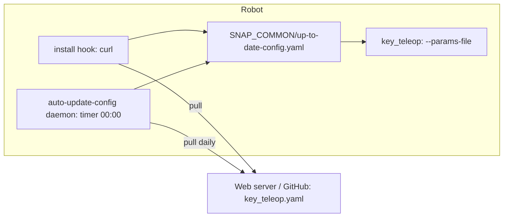
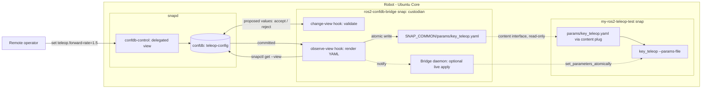
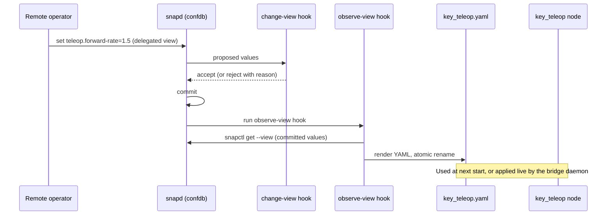

# POC: Remote ROS 2 snap configuration with confdb

## Summary

The Robotics team's current approach, [Configure a snap: pull a configuration from a server](https://canonical-robotics.readthedocs-hosted.com/en/latest/how-to-guides/packaging/config-a-snap-pull-from-a-server/), downloads a ROS 2 parameters YAML file from a web server. The download runs in an `install` hook and then once a day from a timer daemon. This POC replaces the polling with **remote confdb**. An operator changes configuration remotely, snapd validates and commits it on the robot, and the `ros2-confdb-bridge` sidecar snap receives the change event and immediately rewrites the local parameters file used by the ROS 2 application.

## Current approach

The `my-ros2-teleop-test` snap runs `key_teleop` with the `forward_rate`, `backward_rate`, and `rotational_rate` parameters.



Limitations:

- Updates arrive only when the timer runs (daily), with extra delay from server caching.
- Every robot downloads the same file from a hard-coded URL.
- There is no validation: a malformed or out-of-range value only fails when the node starts.
- There is no authentication or authorization model for who may change configuration.
- Each application snap needs `curl`, `network`, a hook, and a timer daemon.

## Proposed approach

The configuration lives in confdb, defined by a signed `confdb-schema`. A remote operator is given access to a view through a `confdb-control` assertion. The `ros2-confdb-bridge` sidecar snap is the view's **custodian**:

- its `change-view-<plug>` hook validates every proposed change and rejects invalid values
- its `observe-view-<plug>` hook runs after the change is committed, reads the committed values with `snapctl get --view`, and atomically rewrites the parameters YAML file
- the file is shared with the application snap through the `content` interface, so `key_teleop` keeps using `--params-file` unchanged.



### Components

| Component | Role |
| --- | --- |
| **`teleop-config` confdb schema** | Typed storage with constraints (for example `forward-rate` is a number with `min` and `max`) and views for the bridge and for operators. |
| **`confdb-control` assertion** | Delegates the operator view to remote operator accounts, with operator-key or store authentication. Delegation is per view and can be revoked. |
| **Bridge `change-view-<plug>` hook** | Validates proposed values against the node's parameter descriptors and rejects invalid ones before commit. |
| **Bridge `observe-view-<plug>` hook** | Runs after commit. Renders the committed values into a ROS 2 parameters YAML file and replaces it atomically (write to a temporary file, then rename). |
| **Bridge `content` slot** | Exposes the bridge's `$SNAP_COMMON/params` directory read-only to application snaps. |
| **Application snap** | Unchanged apart from its content plug. Its launcher passes the shared file to `--params-file`. |
| **Bridge daemon (optional)** | Applies the change to a running node with `/set_parameters_atomically` service, so the new value takes effect without a restart. Otherwise, the new file is used on the next start. |

### Configuration change flow



### Mapping

The confdb paths map to ROS 2 parameters, converting kebab-case to snake_case:

| confdb path | ROS node | Parameter | Type |
| --- | --- | --- | --- |
| `v1.key-teleop.forward-rate` | `/key_teleop` | `forward_rate` | double |
| `v1.key-teleop.backward-rate` | `/key_teleop` | `backward_rate` | double |
| `v1.key-teleop.rotational-rate` | `/key_teleop` | `rotational_rate` | double |

Generated file, identical in format to the file the current approach downloads:

```yaml
key_teleop:
  ros__parameters:
    forward_rate: 1.5
    backward_rate: 4.321
    rotational_rate: 1.0
```

### Snap packaging sketch

`ros2-confdb-bridge`:

```yaml
plugs:
  teleop-config:
    interface: confdb
    account: <publisher-account-id>
    view: teleop-config/bridge
    role: custodian

slots:
  ros-params:
    interface: content
    content: ros-params
    read:
      - $SNAP_COMMON/params

hooks:
  change-view-teleop-config:
    plugs: [teleop-config]
  observe-view-teleop-config:
    plugs: [teleop-config]
```

`my-ros2-teleop-test`: the `install` hook, `curl`, and the `auto-update-config` timer daemon are no longer needed.

```yaml
plugs:
  ros-params:
    interface: content
    content: ros-params
    target: $SNAP_DATA/params
```

```sh
ros2 run key_teleop key_teleop --ros-args --params-file $SNAP_DATA/params/key_teleop.yaml
```

## Comparison

| | Pull from a server | Remote confdb + `ros2-confdb-bridge` |
| --- | --- | --- |
| Update latency | Timer period (daily) plus server cache | Immediate, on commit |
| Validation | None; errors appear when the node starts | Schema constraints and custodian hook, before commit |
| Per-robot configuration | Separate URL or server logic per robot | Native: each device has its own confdb |
| Access control | Whoever can write the hosted file | Signed schema and per-view delegation through `confdb-control` |
| Changes to the application snap | Hook, `curl`, timer daemon, `network` | Content plug only |
| Offline robot | Keeps the last downloaded file | Keeps the last committed values and the rendered file |
| Live update of running nodes | No | Optional, through ROS2's parameters service |
